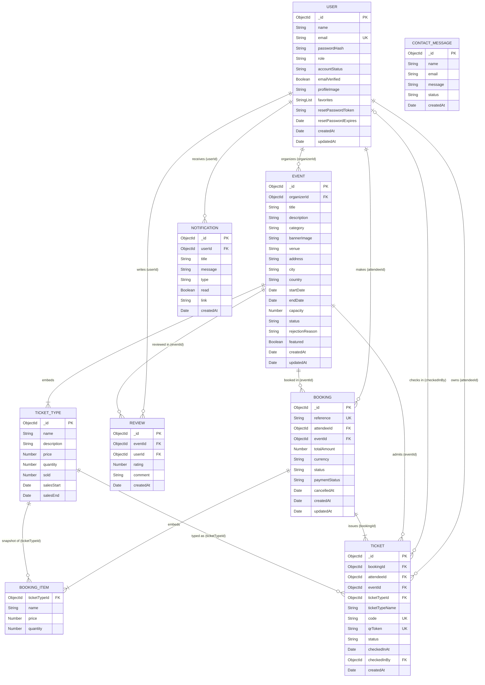

# EventEase – Entity Relationship Diagram

MongoDB (Mongoose) database `eventease`. Boxes are collections; `TICKET_TYPE` and `BOOKING_ITEM` are
**embedded** sub-documents (stored inside `EVENT` and `BOOKING`, not in their own collection).
This diagram renders automatically on GitHub and lists every field. For a larger, easier-to-read picture with the key fields only, use `docs/erd.png` (high resolution, for reports and slides) or `docs/erd.svg`.

## Fields with fixed values

| Collection.field | Allowed values / format |
|---|---|
| User.role | `attendee`, `organizer`, `admin` |
| User.accountStatus | `active`, `suspended` |
| User.passwordHash | bcrypt hash (never the plain password) |
| User.favorites | list of saved event ids |
| Event.category | `music`, `tech`, `food`, `sports`, `arts`, `business`, `education`, `charity` |
| Event.status | `draft`, `pending`, `published`, `rejected`, `cancelled` |
| TicketType.sold | inventory counter, updated atomically when tickets are booked or cancelled |
| Booking.reference | `EE-XXXXXX` (unique) |
| Booking.totalAmount | always calculated by the server, never taken from the client |
| Booking.status | `confirmed`, `cancelled` |
| Booking.paymentStatus | `paid`, `not_required`, `refunded` |
| BookingItem.name, .price | snapshot of the ticket type when it was booked |
| Ticket.code | `TKT-XXXXXX` (unique) |
| Ticket.qrToken | long random value shown as the QR code (unique, contains no personal data) |
| Ticket.status | `valid`, `checked_in`, `cancelled` |
| Review.rating | whole number 1 to 5 |
| Notification.type | `booking`, `event`, `system`, `reminder` |
| ContactMessage.status | `new`, `read`, `archived` |

## Relationships

| Relationship | Type | Implemented by |
|---|---|---|
| User organizes Event | one-to-many | `Event.organizerId` references `User` |
| User makes Booking | one-to-many | `Booking.attendeeId` references `User` |
| Event has Bookings | one-to-many | `Booking.eventId` references `Event` |
| Booking issues Tickets | one-to-many | `Ticket.bookingId` references `Booking` (one ticket per seat) |
| Event has Ticket types | one-to-many, embedded | `Event.ticketTypes[]` sub-documents |
| Booking has Items | one-to-many, embedded | `Booking.items[]` sub-documents (name and price are snapshots) |
| User reviews Event | many-to-many via Review | `Review.userId` + `Review.eventId`; unique pair, so one review per user per event |
| User saves Event (favorites) | many-to-many | `User.favorites[]` holds event ids |
| Ticket checked in by User | many-to-one (optional) | `Ticket.checkedInBy` references the organizer or admin |
| User receives Notifications | one-to-many | `Notification.userId` references `User` |
| Contact message | standalone | no relationships |

## Keys and indexes
- **Primary keys:** every collection has an auto-generated `_id` (ObjectId).
- **Unique:** `User.email`, `Booking.reference`, `Ticket.code`, `Ticket.qrToken`, and the pair `Review(eventId, userId)`.
- **Query indexes:** `Event(status, endDate, category, city)`, `Event(organizerId, status)`, a text index on event title, description, venue and city, `Booking(attendeeId, createdAt)`, `Booking(eventId, status)`, `Ticket(attendeeId)`, `Ticket(eventId, status)`, `Ticket(bookingId)`, `Notification(userId, read, createdAt)`.

## Design decisions (for the viva)
- **Why embed ticket types in the event?** They are always read together with the event, never queried on their own, and the number per event is small. One read returns everything the event page needs.
- **Why snapshot name and price in booking items?** If an organizer later changes a ticket price, old bookings must keep what the customer actually paid.
- **Why a separate Ticket collection?** A booking can contain several seats, and each seat needs its own unique QR code and its own check-in status. Tickets also grow without limit, which is a reason not to embed them.
- **How is overselling prevented?** Each ticket type has a `sold` counter that is updated atomically at booking time, so two buyers cannot take the last seat.
- **Why `favorites` as an array of ids?** The list is small and belongs to one user, so a separate collection would add a join for no benefit.
